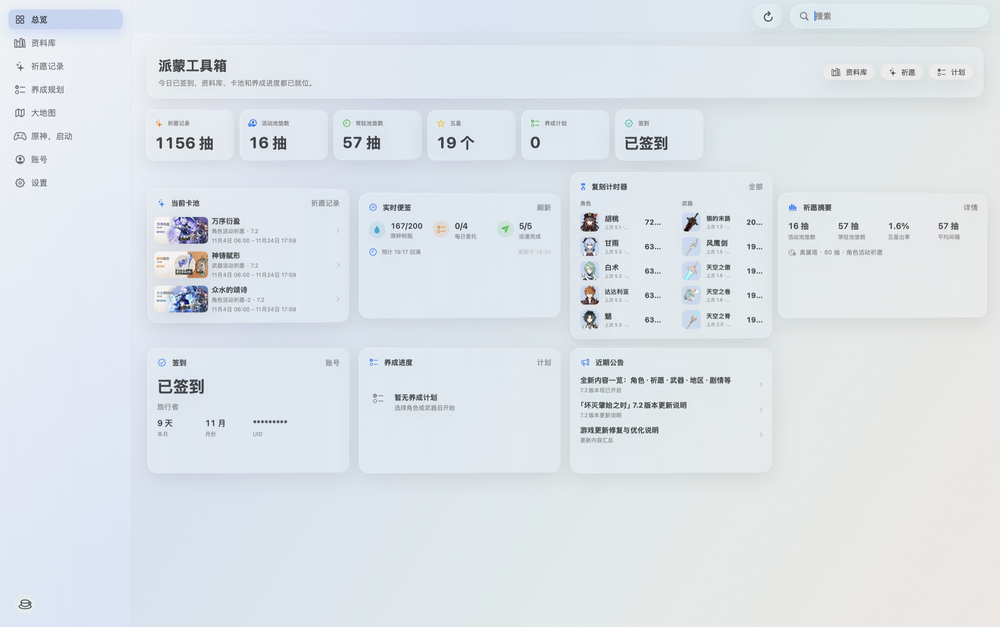
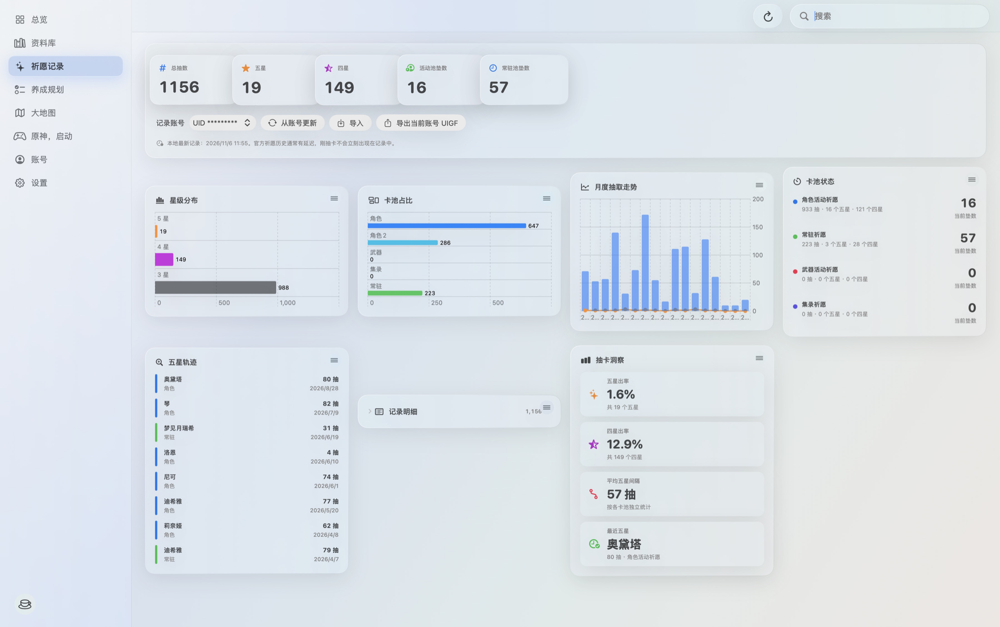
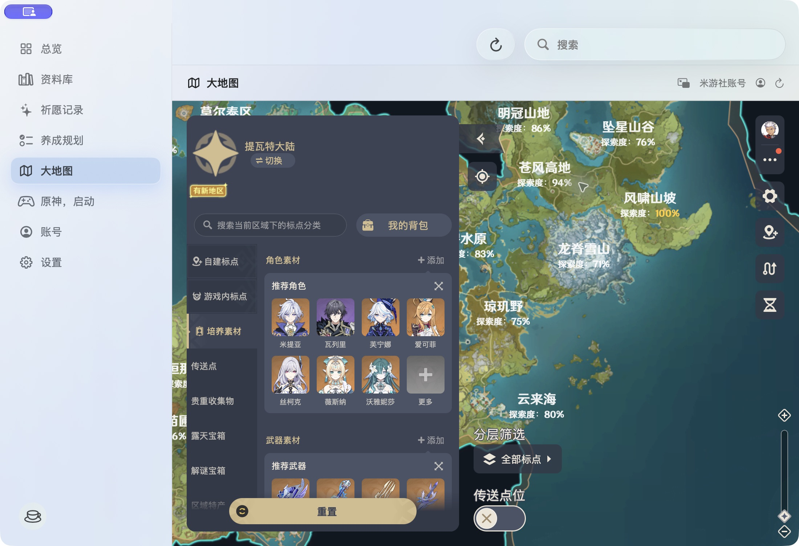

<p align="center">
  
</p>

# 派蒙工具箱

派蒙工具箱是一个 macOS 原神工具应用，当前包含资料库、祈愿记录分析、角色培养规划、米游社扫码登录签到、实时便签、官方大地图、云·原神入口、桌面摆件连接、桌面小组件和软件自动更新能力。

本项目是非官方工具，和 HoYoverse / 米哈游没有从属关系。



祈愿记录统计：



官方大地图：



## 功能

- 角色、武器、材料资料库
- 角色养成材料与培养规划
- 祈愿记录导入、统计和复刻间隔展示
- 米游社扫码登录与每日签到
- 实时便签：原粹树脂、每日委托和探索派遣状态
- 官方公告正文阅读
- 官方大地图与可置顶悬浮地图窗口
- 云·原神网页入口，支持切换栏目后继续运行
- 可自定义侧栏显示栏目
- 局域网桌面 ESP 摆件发现、配对与状态同步
- macOS 桌面小组件
- GitHub Pages 在线数据更新
- 离线 `data-pack-YYYY.MM.DD.zip` 导入兜底
- 软件自动更新与签名校验，GitHub 连接失败时可前往夸克手动下载

## 数据来源

App 默认从公开数据仓库读取生成后的 JSON：

```txt
https://nikolai1997.github.io/paimon-toolbox-data/metadata.json
```

当前数据生成链路见 [docs/data-source-configuration.md](docs/data-source-configuration.md)。

基础资料主要来自公开项目 `theBowja/genshin-db`，卡池信息来自 `SnapHutaoRemasteringProject/Snap.Metadata`，公告来自米哈游官方公告接口。生成后的数据由独立数据仓库发布，App 不直接依赖上游项目运行。

## 安装

当前发布包没有使用 Developer ID 签名，也未经过 Apple 公证。首次打开时，macOS 会提示无法验证开发者，这是未公证 App 的系统行为。

1. 打开 DMG，把“派蒙工具箱”拖入“应用程序”。
2. 在 Finder 的“应用程序”中右键“派蒙工具箱”，选择“打开”。
3. 在再次出现的提示中选择“打开”。
4. 如果仍被阻止，进入“系统设置” > “隐私与安全性”，在安全性提示旁选择“仍要打开”。

安装包可从 [GitHub Releases](https://github.com/nikolai1997/paimon-toolbox/releases/latest) 或[夸克网盘](https://pan.quark.cn/s/2c714884bcfa)获取。每次更新后，macOS 可能会再次要求确认。

## 许可证

代码以 MIT License 开源。第三方项目的版权与许可声明见 [THIRD_PARTY_NOTICES.md](THIRD_PARTY_NOTICES.md)。游戏素材、名称、图标和公告的权利归其各自权利方所有。

## Star 趋势

[](https://www.star-history.com/#nikolai1997/paimon-toolbox&Date)

## 支持开发者

如果派蒙工具箱对你有帮助，欢迎请开发者喝杯咖啡。你的支持，是我持续维护和改进的动力。

| 微信 | 支付宝 |
| :---: | :---: |
|  |  |

感谢打赏，祝老板银行卡余额比我的感谢词还长

自愿赞赏，不影响任何功能的使用。
