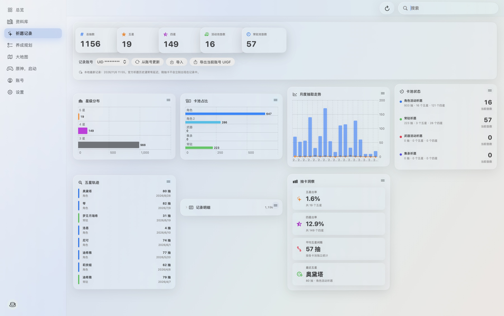

# 派蒙工具箱 0.1.6

- 新增官方大地图，可同步米游社网页登录状态，并支持独立悬浮窗口、置顶及返回主窗口。
- 新增云·原神网页入口，切换栏目后可继续运行，也可主动退出云游戏。
- 新增软件自动更新，使用签名校验安装包；GitHub 连接失败时可前往夸克网盘手动下载。
- 支持自定义侧栏显示栏目。
- 优化祈愿记录页布局，将统计信息和操作按钮分行展示，避免窗口较窄时按钮文字被截断。
- 修复账号切换或退出后云游戏保留旧网页登录会话的问题。
- 更新 GitHub 首页展示图，补充祈愿统计和官方大地图截图，并隐藏截图中的 UID。

## 下载

[GitHub 安装包](https://github.com/nikolai1997/paimon-toolbox/releases/download/v0.1.6/PaimonToolbox-0.1.6.dmg) · [夸克网盘](https://pan.quark.cn/s/2c714884bcfa)

兼容 Apple Silicon 与 Intel，系统要求 macOS 14 或更新版本。

当前安装包未使用 Developer ID 签名，也未经过 Apple 公证。首次打开如被阻止，可在 Finder 中右键应用选择“打开”，或进入“系统设置 > 隐私与安全性”允许打开。

DMG SHA-256：`bf4398780dfed11e1dd42e2160e96b415d5df2cc25bde99453c7acc978437932`

